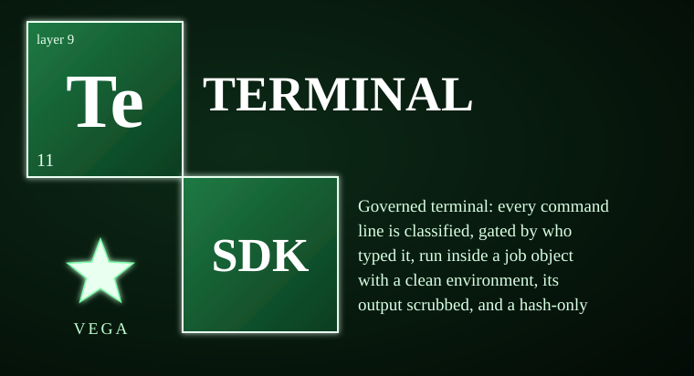

# vega-terminal-sdk



**Governed terminal for people and agents.** Every command line is split without a shell, classified by risk, gated by who typed it, run inside a Windows job object with a clean environment, its output scrubbed for credential-shaped lines, and a hash-only transcript recorded on an append-only custody chain. The one concern this kit owns is **gated command execution** — the boundary where intent becomes action. That boundary matters because a model that can only talk cannot move money, publish packages, or delete files; the moment it can, a single misunderstood or hijacked line can do irreversible damage. This kit makes that boundary explicit, auditable, and fail-closed.

> **Licensing.** Source-available, not open source. Free for personal use; free for registered small businesses (under US$1M revenue and valuation); everyone else needs a commercial license (see LICENSE; for a commercial license write to jasonblasiak.ai.mail@gmail.com). Patent pending (U.S. provisional application 64/178,949 and others). Draft licence text, not yet reviewed by an attorney.

## At a glance

| Property | Value |
|---|---|
| Package | `vega_terminal` (src layout) |
| Version | 0.1.0 |
| Python | ≥3.10 |
| Layer | 9 (interface) |
| Status | BUILT: lex, policy, pathrules, builtins, redact, session |
| Tests | 67 tests in 3 files, all passing |
| Platform | Windows full; Linux/macOS degraded |
| Declared deps | `vega-custody-sdk`, `vega-governance-jacket-sdk` |

## Table of contents

- [Specifications](#specifications)
- [End-to-end functions](#end-to-end-functions)
- [Controls](#controls)
- [What it cannot do](#what-it-cannot-do)
- [Platform support](#platform-support)
- [Standalone & unified install](#standalone--unified-install)
- [Diagnostic control surface](#diagnostic-control-surface)
- [Fail-closed constraints & custom constraints](#fail-closed-constraints--custom-constraints)
- [Family role](#family-role)
- [License & scope](#license--scope)

---

## Specifications

| Property | Value |
|---|---|
| Package | `vega_terminal` (src layout) |
| Version | 0.1.0 |
| Python | ≥3.10 |
| Declared dependencies | `vega-custody-sdk`, `vega-governance-jacket-sdk` |
| Family SDKs imported (down-layer only) | `vega_custody` (dag, ledger, safepaths, proc), `vega_jacket` (humanauth, commit, gate) |
| Tests | 67 tests in 3 files, all passing |
| Status | BUILT: lex, policy, pathrules, builtins, redact, session. DESIGNED ONLY: Electron terminal tab wiring; redirect support limited to `>` and `>>` on last stage of a pipeline. |

---

## End-to-end functions

1. **Input arrives on a channel** — `run_human(line)` for keystrokes from the person at the terminal; `run_agent(line)` for anything a model, script, or agent sends. The channel decides the origin; nothing inside the line can change it.
2. **Lex without a shell** — `lex.split()` parses the line into stages separated by `;`, `&&`, `||`, `|`, newline. Any shell expansion syntax (`$`, `` ` ``, `^`, `%VAR%`, braces, parentheses) marks the line **OPAQUE** and it is refused. Background `&`, input redirection `<`, numbered redirection `2>`, pipes with nothing after `|` are refused.
3. **Classify every stage** — `policy.classify_stage()` assigns the worst class among stages: READ, WRITE, NETWORK, EXEC, UNKNOWN, DESTRUCTIVE, OUTSIDE, SENSITIVE, HUMAN_ONLY. Built-in read commands (ls, cat, head, tail, wc, grep, pwd, echo, cd) are READ when given bare names and workspace paths. Git read subcommands with safe flags are READ. Publish, pay, and key-change programs map to canonical HUMAN_ONLY actions (`release_public`, `spend_funds`, `change_key_registry`).
4. **Signature gate** — An agent may auto-run READ only. A person may auto-run everything except HUMAN_ONLY. Anything else needs a human-signed single-use commitment for exactly this line and folder, checked and burned by the exit gate (`vega_jacket.gate.ExitGate.release()`).
5. **Record intent before execution** — The intent (origin, line hash, class, action, stages, commitment leaf if any) is written to the custody DAG as `TERMINAL_INTENT`. If recording fails, nothing runs (fail-closed).
6. **Execute** — Built-in read commands run in Python with no subprocess. External programs run inside a Windows job object with: a clean environment (only SYSTEMROOT, WINDIR, COMSPEC, PATHEXT, SYSTEMDRIVE, NUMBER_OF_PROCESSORS, PROCESSOR_ARCHITECTURE, OS, LANG, TZ kept; PATH filtered to absolute folders outside the workspace; HOME, USERPROFILE, APPDATA, LOCALAPPDATA, XDG_CONFIG_HOME, TEMP, TMP redirected to a per-session scratch directory; git config hardened); a 30-second default timeout; a 64 KiB output cap (2× in memory); a survivor check that kills detached descendants.
7. **Scrub output** — `redact.strip_controls()` removes terminal escape sequences. `redact.scrub()` replaces credential-shaped lines (single lines and each pair of neighbouring lines joined with newline or nothing) with `[REDACTED: credential-shaped line]`.
8. **Record result** — The result (status, exit codes, output SHA-256, output length, redacted line count, truncated flag, survivor count, timed_out flag, commitment leaf) is written as `TERMINAL_RESULT`. If recording fails, the output is withheld (fail-closed).
9. **Hard stop** — `halt()` kills the running job and sets `halted=True`. Every subsequent line is refused until `resume(signed)` receives a valid `restore_after_hard_stop` commitment.

---

## Controls

| Control | Location | What it does |
|---|---|---|
| `run_human(line, signed=None)` | `session.Session` | Execute a line typed by the person; auto-runs non-HUMAN_ONLY classes; requires signed commitment for HUMAN_ONLY. |
| `run_agent(line, signed=None)` | `session.Session` | Execute a line from an agent/model; auto-runs READ only; requires signed commitment for everything else. |
| `plan(line, origin)` | `session.Session` | Dry-run classification without execution; returns `cls`, `stages`, `action`, `need_signature`, `refused`. |
| `halt()` | `session.Session` | Kill the running job, record `TERMINAL_HALT`, refuse all subsequent lines. |
| `resume(signed)` | `session.Session` | Accept a `restore_after_hard_stop` commitment; clear `halted`; record `TERMINAL_RESUME`. |
| `timeout` (constructor) | `session.Session.__init__` | Per-command wall-clock limit in seconds (default 30.0). |
| `OUT_CAP` (module constant) | `session.OUT_CAP` | Output byte cap before truncation (default 64 KiB). |
| `ENV_KEEP` (module constant) | `session.ENV_KEEP` | Environment variables allowed through to child processes. |
| `GIT_SAFE` (module constant) | `session.GIT_SAFE` | Hardened git flags forced on every git invocation. |
| `MAX_LINE` / `MAX_STAGES` | `lex.MAX_LINE`, `lex.MAX_STAGES` | Line length limit (8192) and pipeline stage limit (16). |
| `FILE_CAP` / `LIST_CAP` | `builtins.FILE_CAP`, `builtins.LIST_CAP` | Built-in file read cap (1 MiB) and directory listing cap (1000 entries). |

---

## What it cannot do

- It cannot tell who is typing: the application must feed keystrokes to `run_human` and agent output to `run_agent`; an agent that can inject keystrokes into the person's terminal defeats the origin check.
- Output scrubbing is pattern matching, not a seal: a secret split over three or more lines, or encoded, is not caught.
- Job-object containment is not an operating-system sandbox; a program can still use the user's real profile through system calls.
- Git hardening covers the settings known to run programs; it is not a proof that every git read command is safe.
- The Windows job object and clean-environment logic are Windows-specific; on non-Windows platforms the containment layer degrades to basic subprocess execution without job-object isolation.
- Not production-hardened.
- Not independently security-reviewed.
- Cryptography not expert-reviewed.
- The licence text is a draft not reviewed by an attorney.

---

## Platform support

| Platform | Support level | Notes |
|---|---|---|
| Windows (CPython 3.10+) | Full | Job object containment, clean environment, survivor check, hardened PATH — all implemented via `vega_custody.proc.ProcessJob`. |
| Linux (CPython 3.10+) | Degraded | Falls back to `subprocess.Popen` without job object; no survivor check; clean environment and PATH filtering still apply. |
| macOS (CPython 3.10+) | Degraded | Same as Linux; no job object equivalent in the current code. |
| Android (Termux) | Not tested | Pure Python; would run inside Termux but job object containment unavailable. |
| iOS (BeeWare/Kivy) | Not tested | Pure Python; would run inside an embedded runtime but job object containment unavailable. |

> No native mobile build is published. The SDK is pure Python and can run inside a Python runtime on Android (Termux) or Apple platforms (BeeWare/Kivy) where that runtime supports its dependencies. Hardware-dependent capabilities (job object, survivor check) are Windows-only; designed or partial per STATUS.md.

---

## Standalone & unified install

**Standalone:** `pip install -e .` installs the package with its two declared dependencies (`vega-custody-sdk`, `vega-governance-jacket-sdk`). It imports only down-layer family SDKs: `vega_custody` (dag, ledger, safepaths, proc) and `vega_jacket` (humanauth, commit, gate). It does not import any peer or up-layer SDKs. It installs and runs alone with zero up-layer family dependencies.

**Unified:** Registered in `vega-umbrella-sdk` as layer 9 (interface). The registry entry (verbatim from `vega_umbrella.registry.REGISTRY`):

```python
"vega-terminal-sdk": {
    "layer": 9,
    "concern": "gated command execution for people and agents",
    "requires": ["vega-custody-sdk", "vega-governance-jacket-sdk"],
    "provides": ["session", "lex", "policy", "pathrules", "builtins", "redact"],
}
```

The umbrella resolves inter-SDK wiring; this kit does not import `vega_umbrella` or any layer ≥10 SDK.

---

## Diagnostic control surface

- **CLI entry points:** None (no `console_scripts` in pyproject.toml).
- **Introspection functions:** `Session.plan(line, origin)` returns the full classification without executing; `Session.params_for(line)` returns the parameters the gate uses (`line_sha256`, `cwd`).
- **Log surfaces:** Every decision writes to the custody DAG (`TERMINAL_INTENT`, `TERMINAL_RESULT`, `TERMINAL_REFUSED`, `TERMINAL_DENIED`, `TERMINAL_HALT`, `TERMINAL_RESUME`). The DAG is append-only and hash-chained; `dag.verify()` confirms integrity.
- **Exit codes:** Built-ins return 0 on success, 1 on refusal, 2 on builtin error, 126 on could-not-start, 127 on program-not-found. External programs return their process exit code.
- **Fail-closed indicators:** `status="not_recorded"` (intent or result could not be written), `status="denied"` (gate refused), `status="refused"` (lexer or policy refused), `status="halted"` (terminal halted), `timed_out=True`, `left_processes>0`, `recorded=False`.
- **Environment variables honored:** None directly; `ENV_KEEP` tuple in `session.py` controls what passes to children. The gate uses `VEGA_JACKET_*` env vars internally (see `vega-governance-jacket-sdk`).

---

## Fail-closed constraints & custom constraints

### Fail-closed constraint points (module + function)

1. `lex.split()` — refuses NUL, over-length, control characters, expansion syntax, unsupported separators, unterminated quotes, empty commands, too many stages, redirected stage feeding a pipe → raises `lex.Refused`.
2. `policy.classify_stage()` — refuses non-ASCII program names, script launchers (`.bat`, `.ps1`, etc.), empty program names → raises `lex.Refused`.
3. `pathrules.check()` — refuses NUL, UNC/device/alternate-data-stream paths, glob/tilde expansion, paths outside workspace after symlink resolution, sensitive-name paths → returns flags `outside`, `device`, `sensitive` that raise classification.
4. `session.Session._run_locked()` — if `halted`, refuses immediately; if `plan.refused`, records `TERMINAL_REFUSED` and refuses; if `plan.need_signature` and no valid gate/signature, records `TERMINAL_DENIED` and refuses; if intent cannot be recorded (`TERMINAL_INTENT`), refuses; if result cannot be recorded (`TERMINAL_RESULT`), withholds output.
5. `session.Session._execute()` — timeout kills job; survivor check kills detached descendants; output cap truncates; redirect failures set exit code 1.
6. `session.Session.resume()` — refuses if no gate or invalid `restore_after_hard_stop` commitment.

### Custom constraints

This version publishes no user-defined constraint hooks; constraints are fixed by the module and the jurisdiction floor.

> **User-defined constraints may be STRICTER than the legal minimum for the applicable jurisdiction, never looser. Jurisdictional legal minimums are defined by the jurisdiction registry (vega-jurisdiction-sdk); a custom constraint that would drop below a registered minimum is rejected at the gate.**

---

## Family role

This kit is **layer 9 (interface)** in the 16-layer Vega organism. It depends **down** on layer 0 (`vega-custody-sdk`: DAG, ledger, safepaths, proc) and layer 1 (`vega-governance-jacket-sdk`: humanauth, commit, gate). It is consumed **up** by layer 15 (`vega-umbrella-sdk`: registry, pre-deploy audit). No layer 10–14 SDK imports this kit. One family, one organism: every SDK owns exactly one concern and uses the owner of every other concern instead of growing its own copy.

---

## License & scope

> **Licensing.** Source-available, not open source. Free for personal use; free for registered small businesses (under US$1M revenue and valuation); everyone else needs a commercial license (see LICENSE; for a commercial license write to jasonblasiak.ai.mail@gmail.com). Patent pending (U.S. provisional application 64/178,949 and others). Draft licence text, not yet reviewed by an attorney.

---

**This kit details one branch of a broader filed architecture. The remaining branches are the subject of filed disclosures and are outside the scope of this repository.**
